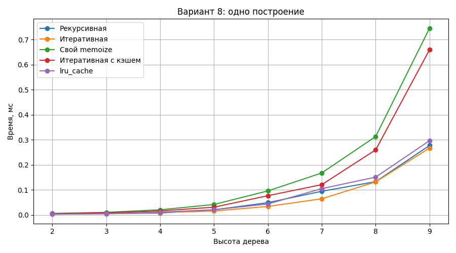
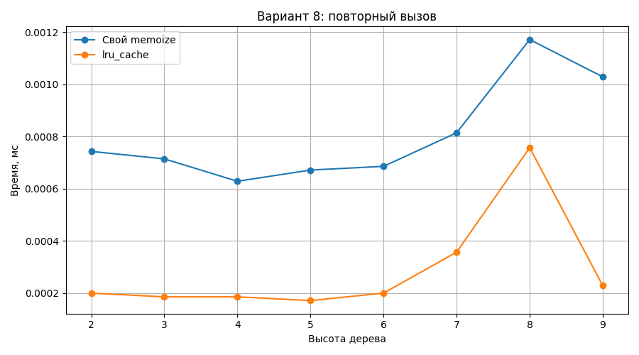
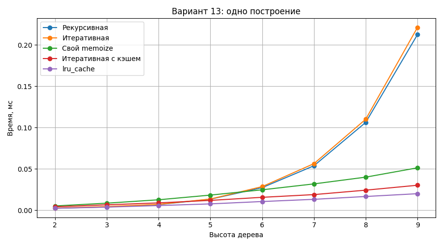
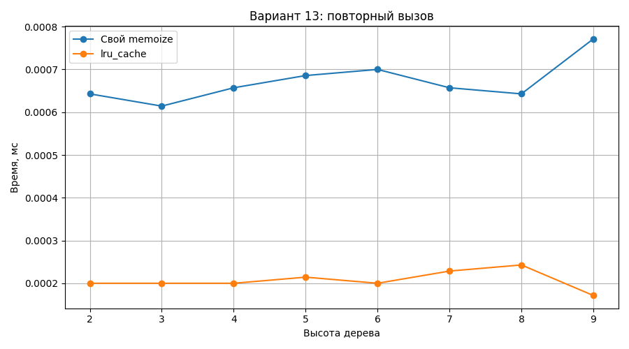

# Лабораторная работа. Мемоизация бинарного дерева

**Вариант 8**, сравнение с вариантом 13.

## Задача

Сравнить построение бинарного дерева с мемоизацией и без неё. Дерево хранится в словаре с ключами `value`, `left`, `right`.

- Вариант 8: `root=8`, `height=4`, слева `x + x/2`, справа `x**2`.
- Вариант 13: `root=13`, `height=3`, слева `x+1`, справа `x-1`.

## Решение

В `app.py` находятся пять функций: обычные рекурсивная и итеративная (из ЛР 3 и 4), рекурсивная с `@memoize`, итеративная с локальным словарём и рекурсивная с `@lru_cache(maxsize=None)`. Декоратор `memoize` использует `wraps`, учитывает `*args` и `**kwargs`, считает `hits` и `misses` и позволяет очищать кэш через `cache_clear()`.

В `benchmark.py` используется `timeit`: 7 запусков для каждой высоты **от 2 до 9**. Перед замерами одного построения кэш очищается. Для повторного вызова сначала строится дерево, затем замеряется следующий вызов с теми же аргументами. При высоте 10 в варианте 8 возможен `OverflowError` из-за больших чисел; при высоте 9 обычное построение укладывается в 1 секунду.

## Результаты

Среднее время одного построения, **мс** (несколько высот из измеренного диапазона):

| Вариант | Высота | Рекурсивная | Итеративная | `memoize` | Итеративная с кэшем | `lru_cache` |
|---|---:|---:|---:|---:|---:|---:|
| 8 | 2 | 0.0031 | 0.0036 | 0.0051 | 0.0055 | 0.0025 |
| 8 | 5 | 0.0132 | 0.0141 | 0.0326 | 0.0376 | 0.0178 |
| 8 | 9 | 0.2429 | 0.3560 | 0.5128 | 0.7837 | 0.2581 |
| 13 | 2 | 0.0022 | 0.0026 | 0.0041 | 0.0037 | 0.0020 |
| 13 | 5 | 0.0114 | 0.0120 | 0.0130 | 0.0102 | 0.0058 |
| 13 | 9 | 0.2243 | 0.2246 | 0.0670 | 0.0643 | 0.0164 |

Повторный вызов на высоте 9 (кэш уже заполнен):

| Вариант | `memoize`, мс | `lru_cache`, мс |
|---|---:|---:|
| 8 | 0.000908 | 0.000359 |
| 13 | 0.000551 | 0.000185 |

Количество вызовов **каждой** из функций `left_leaf` и `right_leaf` при высоте 9:

| Вариант | Без кэша | С кэшем |
|---|---:|---:|
| 8 | 511 | 412 |
| 13 | 511 | 45 |

После построения варианта 13 с `lru_cache` при высоте 9: `CacheInfo(hits=36, misses=55, maxsize=None, currsize=55)`.

### Графики









## Выводы

В варианте 13 одинаковые поддеревья встречаются чаще: на высоте 9 `lru_cache` ускоряет построение примерно **в 13,7 раза**, а свой `memoize` — **в 3,3 раза**. В варианте 8 повторений меньше, поэтому при высоте 9 свой декоратор оказался примерно **в 2,1 раза медленнее**, а `lru_cache` — немного медленнее обычной рекурсии. На малых высотах затраты на кэш часто превышают выигрыш; результаты коротких замеров зависят от нагрузки компьютера.

`lru_cache` обычно быстрее собственного декоратора, так как его реализация оптимизирована. Вызов `memoize(gen_bin_tree_recursive)` запоминает только готовое целое дерево, а не поддеревья: внутри исходной функции рекурсия по-прежнему идёт без кэша. При `@memoize` рекурсивные вызовы обращаются к обёртке. Новые объекты `lambda` при каждом вызове создают новые ключи кэша, поэтому результаты не переиспользуются между такими вызовами.

Мемоизация может сделать одинаковые поддеревья **одним объектом** (`is` возвращает `True`). Изменение словаря сразу видно в нескольких ветках, а при общем кэше — и при следующем вызове. Чтобы избежать этого, дерево лучше не изменять или делать глубокую копию перед изменением.

## Запуск

```bash
pip install matplotlib
python -m unittest test_app.py -v
python benchmark.py
```

`benchmark.py` выводит таблицы в консоль и создаёт четыре PNG-графика. CSV-файлы не используются.
